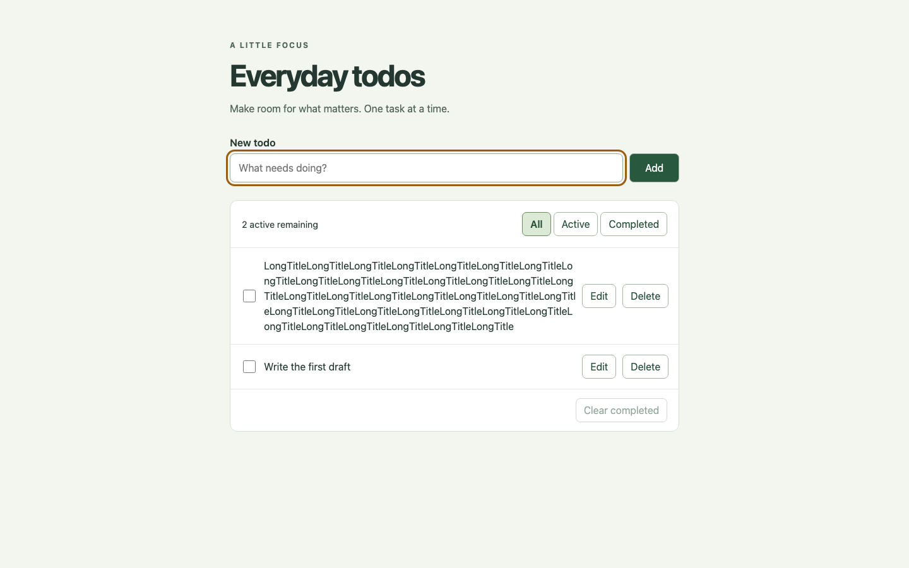
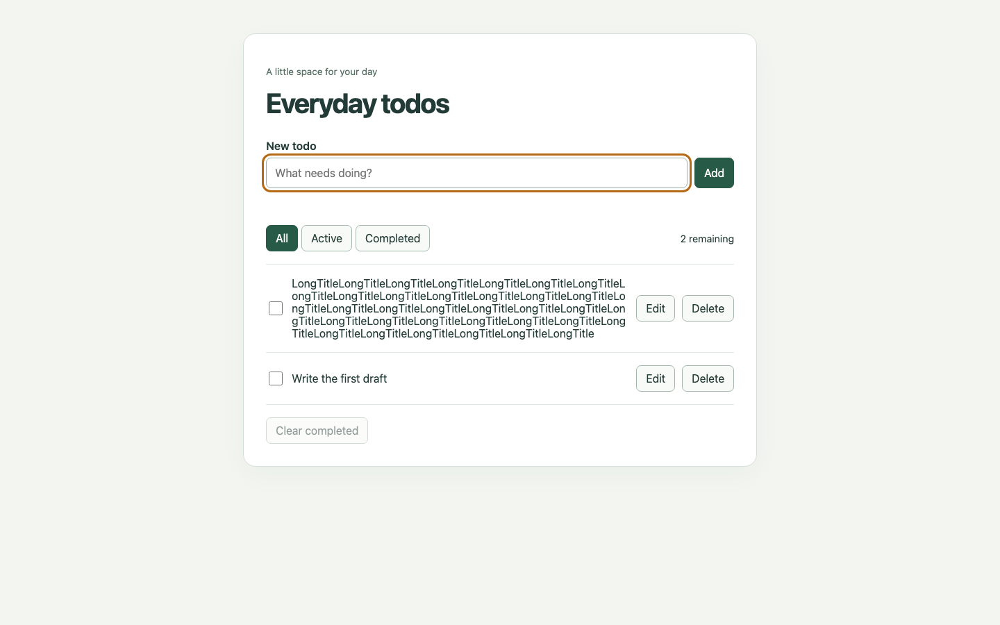
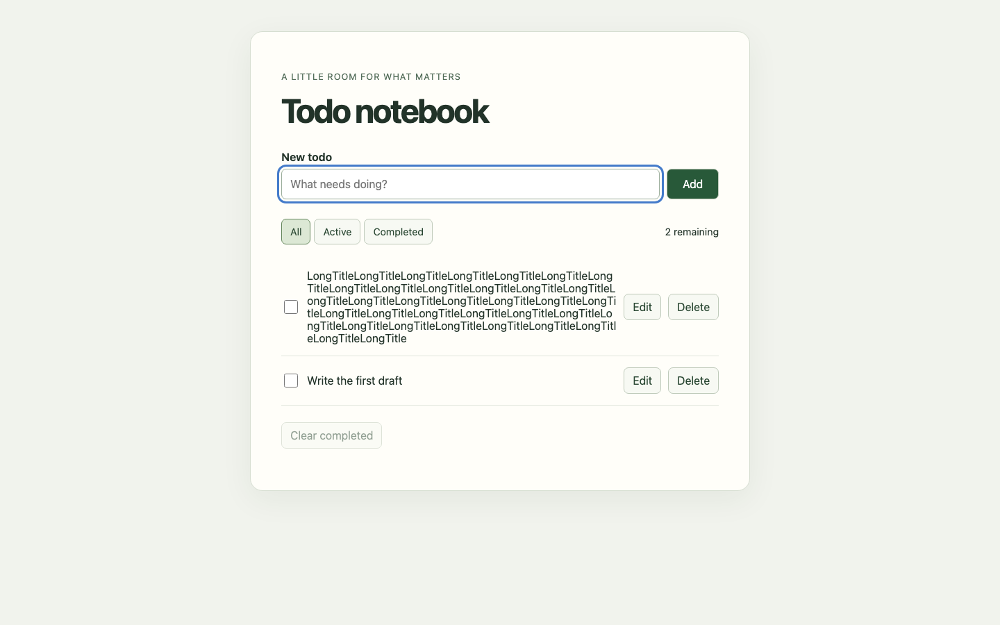
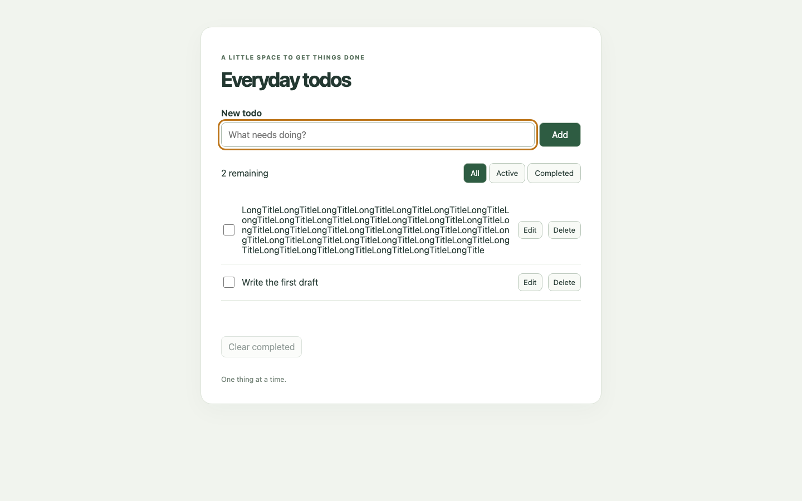

# Does Lean-first improve a todo app's first draft?

**Pilot result: no demonstrated correctness, edge-discovery, cleanliness, or speed
advantage.** Both Lean-first runs produced useful checked identity-allocation
properties, but all four apps passed the same acceptance suite and the blinded
review preferred the baseline source for readability. This supports keeping the
skill experimental and selective, not making Lean a default step for CRUD apps.

## Experiment

On 2026-10-31, four fresh-context implementation agents were dispatched with
`model: gpt-6.1-sol`: two baseline and two Lean-first runs. All received the same
[task](task.md), empty starting folders, Node/Playwright/Lean availability, and
`finish-with-evidence`. Only treatment received `lean-first` and the instruction
to use it before implementation. Baseline means **without lean-first**, not without
all workflow guidance. No implementer saw evaluator tests or other submissions.

The [protocol](protocol.md), task, and skill were fixed before implementation.
The domain checks were written before reading submissions; browser checks were
completed before reading implementation files. We allowed normal self-testing
during a run, then hashed the submitted first drafts before shared evaluation.
No submission was repaired in response to evaluator results. Original projects,
their self-tests, notes, and execution logs remain in [projects](projects/).

## Frozen acceptance results

| Submission | Domain checks | Browser workflows | Model proof lines | Blinded clarity |
| --- | ---: | ---: | ---: | --- |
| baseline-1 | 19/19 | 10/10 | 0 | Tied first |
| baseline-2 | 19/19 | 10/10 | 0 | Tied first |
| lean-1 | 19/19 | 10/10 | 41 | Fourth, modest difference |
| lean-2 | 19/19 | 10/10 | 32 | Third, weak separation from fourth |

The 19 domain checks include 5,000 seeded mixed operations **per app**, Unicode
whitespace, duplicate titles, immutability, allocation after delete/reload,
safe-integer exhaustion, and atomic rejection of malformed snapshots. Browser
checks exercise real Chromium from fresh contexts: keyboard add/toggle, edit and
cancel, filtering/counting/clearing, reload, hostile title text, corrupt storage,
read/write failures, and horizontal overflow at 320/768/1024/1440px.

All 116 named acceptance checks passed. This is not exhaustive testing, and the
20,000 operation steps are not 20,000 independent test cases. See the machine-readable
[results](evidence/results.json), per-app TAP/JSON files, and
[unchanged first-draft hashes](evidence/first-draft-hashes.json).

Both Lean files independently passed Lean 4.35.0 with warnings treated as errors.
They model lists of identities and an allocator, **not the entire todo state machine**.
They check allocation bounds/freshness; lean-1 also proves deletion preserves its
validity predicate. That predicate does not include uniqueness. Both disclose this
limit and connect one executable delete/add trace to production JavaScript tests.
Neither agent reported a new design decision or a real bug discovered by modeling.
There is no TypeScript/JavaScript equivalence proof, and Nat does not model JavaScript
safe-integer bounds, Unicode trimming, DOM state, or storage failure.

An independent fresh-context worker tested three negative controls on disposable
copies: a length-based JS allocator and a missing allocator increment in each Lean
model. Each had passing baseline/restored runs and the intended behavioral/proof
failure under mutation. The JS fault failed five checks. These are synthetic
faults, not discovered production bugs. [Full evidence](evidence/negative-controls.json).

## Code clarity and exploratory counterexamples

A fresh Sol 6.1 reviewer saw only production files under anonymous labels, without
condition labels, proofs, notes, or test outcomes. It ranked **A ≈ C > D > B**:
baseline-2 ≈ baseline-1 > lean-2 > lean-1. The [review](evidence/blind-review.md)
contains file/line reasoning; the [mapping](evidence/blind-mapping.json) was withheld
until review completion. This is one subjective review, not a calibrated score.

All apps use a small pure-domain/UI split without runtime dependencies. Lean runs
have fewer source lines largely because of denser formatting (lean-2 has a one-line
stylesheet). Fewer lines did not establish cleaner code. The reviewer favored
explicit action branches and readable handlers, while noting lean-2's useful
dispatch-success and focus-handling details. Raw bytes/lines are in results.json;
model files are reported separately.

After the frozen evaluation, we reproduced three reviewer hypotheses equally on
all four apps using [explore-ui.mjs](explore-ui.mjs). These are **post-hoc observations,
not extra failures retroactively added to the acceptance score**:

| Interaction | Baseline 1 | Baseline 2 | Lean 1 | Lean 2 |
| --- | --- | --- | --- | --- |
| Edit a draft, then add another todo | Draft reset | Draft reset | Draft reset | Draft reset |
| Submit when allocator is exhausted | Input cleared | Input cleared | Input cleared | Input retained |
| Save fails, then submit blank title | Save warning retained | Retained | Replaced by blank-title warning | Retained |

The draft-reset observation is a useful UI-state gap shared by both approaches.
The exhausted-allocator behavior correctly adds no item in all four; retention is
a UX distinction, not a violation of the frozen domain rule. Lean-1's status message
replacement illustrates a concern outside its proved boundary. No exploratory
finding was patched into the saved first drafts.

## Cost, adherence, and limits

- Both treatment agents actually wrote and ran Lean models, recorded commands and
  proof scope, and checked a matching JS trace. Their logs and independent compiler
  runs are evidence of execution, not merely claims that a skill was loaded.
- Lean-1's initial proof attempt produced tactic/library errors before correction.
  Those are proof-development costs, not bugs found in the application.
- The models add 73 lines plus proof/trace maintenance. Both record version 4.35.0;
  neither submission supplied a lean-toolchain file. This benchmark pins the version
  centrally, but that is a packaging addition, not first-draft compliance credit.
- Dispatch/completion observation bounds are recorded in
  [execution.json](evidence/execution.json). The first three runs overlapped; the
  fourth ran later. These are not clean per-run compute timings. Token/dollar cost
  was not exposed, so **no speed or cost ranking is claimed**.
- The rich shared contract already names many edge cases, creating a ceiling effect
  and limiting conclusions about discovering unstated requirements. Two samples per
  arm, one task, one machine, and one same-model reviewer cannot establish general
  benefits or harms. First draft means first submitted, self-tested result, not the
  first keystrokes. Common host instructions also apply to all agents.
- Desktop screenshots were inspected and narrow layout was checked programmatically.
  No real-device, cross-browser, exhaustive keyboard, or manual screen-reader claim.
- The skill-creator Python validator could not import PyYAML. The existing Node YAML
  parser validated frontmatter/name/description/placeholders instead; behavioral
  validation is the experiment above, not that metadata check.

## Reproduce

Node 26.5.0, Playwright 1.63.0/Chromium, Lean 4.35.0 were used. The apps themselves
need no packages: from any project directory run `python3 -m http.server 8000
--bind 127.0.0.1` and open localhost:8000. Every app uses the same localStorage key;
use separate browser contexts/ports or clear storage between manual comparisons.

From the repository root:

```bash
node --test-reporter=tap benchmarks/lean-first-todo/check-domain.mjs benchmarks/lean-first-todo/projects/baseline-1
PLAYWRIGHT_MODULE=/absolute/path/to/playwright/index.mjs node benchmarks/lean-first-todo/check-browser.mjs benchmarks/lean-first-todo/projects/baseline-1
PLAYWRIGHT_MODULE=/absolute/path/to/playwright/index.mjs node benchmarks/lean-first-todo/explore-ui.mjs benchmarks/lean-first-todo/projects/baseline-1
```

Repeat for baseline-2, lean-1, lean-2. The browser scripts accept an existing
Playwright installation through PLAYWRIGHT_MODULE, or resolve `playwright` normally
when it is installed. Set SCREENSHOT_PATH on check-browser.mjs to save a screenshot.
Do not overwrite committed evidence when recording a new run. The implementers'
own browser tests intentionally retain the host paths from the original trials;
use the portable shared harness above for comparison.

With elan/Lean on PATH:

```bash
cd benchmarks/lean-first-todo
lean -DwarningAsError=true projects/lean-1/Model.lean
lean -DwarningAsError=true projects/lean-2/Model.lean
```

The Lean-first skill itself remains the frozen tested version. Use it selectively
for consequential pure logic with meaningful invariants, and measure any claimed
improvement on the actual workload. This experiment does not justify forcing it
onto ordinary todo/CRUD development.

## Screenshots of frozen submissions

| Baseline 1 | Lean-first 1 |
| --- | --- |
|  |  |

| Baseline 2 | Lean-first 2 |
| --- | --- |
|  |  |
